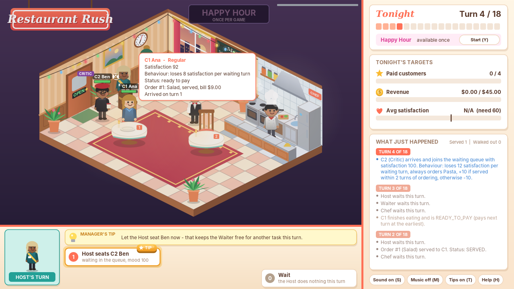
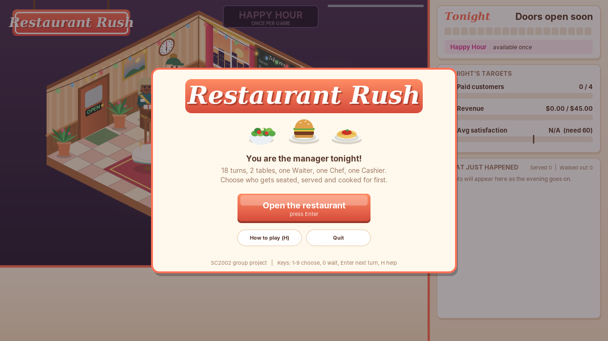
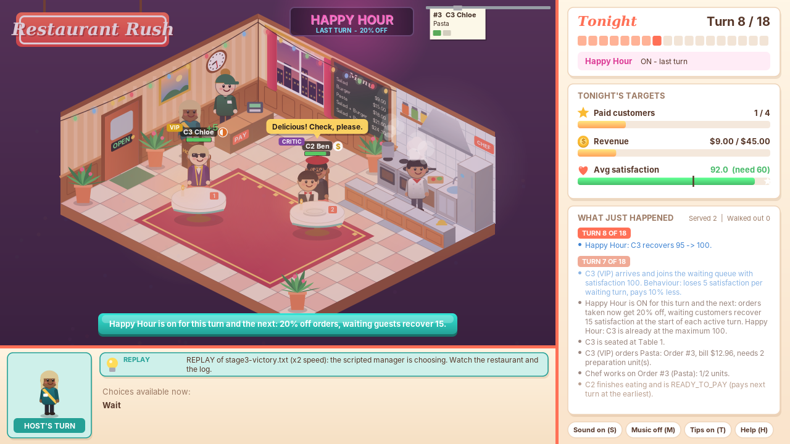
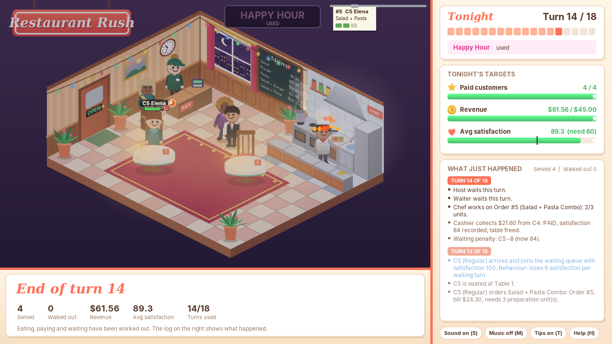
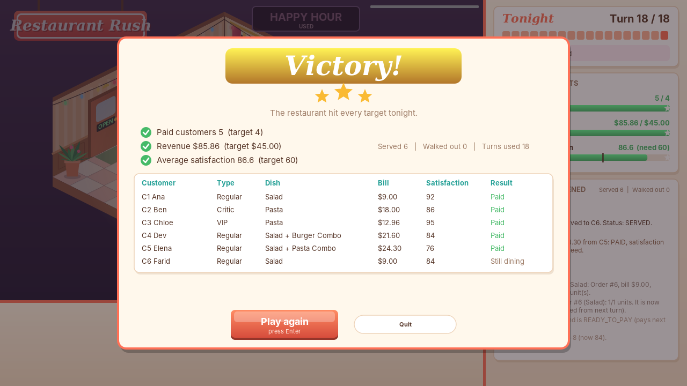

# Restaurant Rush (SC2002 group assignment)

A turn-based restaurant management game for the command line. You are the manager:
each turn you give the Waiter and the Chef one task each, and after 18 turns the
restaurant must reach the targets to win.

**Repository:** [GitHub URL — fill in]

**Group:** [Lab group / group number — fill in] · **Members:** [names — fill in]

## Build and run

Requires Java 11 or newer (JDK). No external libraries and no network access needed.

```sh
./run.sh                 # Linux / macOS: compiles into out/ and starts the game
run.bat                  # Windows
./run-tests.sh           # compiles and runs the rule tests
```

Manual equivalent:

```sh
javac -d out $(find src -name "*.java")       # Linux / macOS
javac -d out -sourcepath src src\rush\Main.java  # Windows (cmd or PowerShell)
java -cp out rush.Main
```

In an IDE (IntelliJ, Eclipse, VS Code), mark `src` as the source root and run `rush.Main`.

## Game window (2D)

The same game also runs in a drawn, animated window: an isometric restaurant with a
waiter, chef, cashier and customers who walk in, sit, order, eat and pay. It uses
exactly the same `GameController`, so every rule and result is identical to the
command line.



| | |
|---|---|
|  |  |
|  |  |

**Easiest way to play:** run `./build-jar.sh` (or `build-jar.bat`) once, then double-click
`RestaurantRush.jar`. The same jar runs the console version with `java -cp RestaurantRush.jar rush.Main`.

```sh
./run-gui.sh                                   # Linux / macOS
run-gui.bat                                    # Windows
java -cp out rush.gui.GuiMain                  # after compiling
java -cp out rush.gui.GuiMain --replay tests/stage1-victory.txt --speed 2   # watch a test script
```

- Click a choice (or press 1-9, 0 to wait, Enter for the next turn).
- The yellow **Manager's tip** suggests a sensible move and marks it with a TIP badge (T turns tips off).
- **Help** (H) explains the rules; hover over a customer for their mood, order and progress.
- A refused choice shows the reason and does not use up the task.
- S toggles sound effects, M the background music (both are generated in code; silent if there is no sound device).

Scripted, reproducible runs are described in [tests/TEST_NOTES.md](tests/TEST_NOTES.md).
Each stage's scripts are meant for that stage's tag: `git checkout stage-1` (or `stage-2`, `stage-3`) first.

## Design documents

- Class diagram (final, Stage 3): [docs/uml/class-diagram.png](docs/uml/class-diagram.png) · [SVG](docs/uml/class-diagram.svg) · [PlantUML source](docs/uml/class-diagram.puml)
- Game window classes (`rush.gui`): [docs/uml/gui-class-diagram.png](docs/uml/gui-class-diagram.png) · [SVG](docs/uml/gui-class-diagram.svg) · [PlantUML source](docs/uml/gui-class-diagram.puml)
- Sequence diagram (VIP order with Happy Hour, arrival → payment → result): [docs/uml/sequence-diagram.png](docs/uml/sequence-diagram.png) · [SVG](docs/uml/sequence-diagram.svg) · [PlantUML source](docs/uml/sequence-diagram.puml)
- The PDF report (design discussion, functional evidence, reflections) is submitted alongside this repository.

## Video timestamps

| # | Segment | Timestamp |
|---|---|---|
| 1 | The game launching from the submitted project | [mm:ss] |
| 2 | Meaningful manager choices, including a decision where staff are constrained | [mm:ss] |
| 3 | A dish going READY → SERVED → payment | [mm:ss] |
| 4 | A VIP or Critic behaviour | [mm:ss] |
| 5 | A Stage 3 feature | [mm:ss] |
| 6 | One victory and one defeat | [mm:ss] |
| 7 | The stage tag comparisons and the diagrams | [mm:ss] |

## Stages

| Tag | Adds |
|---|---|
| `stage-1` | Regular customers, menu, Waiter, Chef, Cashier, tables, waiting queue, full turn sequence, victory and defeat |
| `stage-2` | VIP and Critic customers |
| `stage-3` | Host, ComboMeal, Happy Hour |

### Customer types (Stage 2)

| Type | Loss per waiting turn | Bill | Special behaviour |
|---|---|---|---|
| Regular | 8 | full price | — |
| VIP | 5 | 10% off | — |
| Critic | 12 | full price | Always orders the signature **Pasta**. Reacts to service speed: served within 2 turns of ordering → impressed, +10 satisfaction; slower → complains, −10. |

Food choice rule (Regular and VIP): customer number *n* orders menu item ((n − 1) mod menu size) + 1.

## Stage 1 → Stage 2 changes

**New files**
- `domain/VIPCustomer.java` — overrides loss per turn (5) and `adjustBill` (10% off).
- `domain/CriticCustomer.java` — overrides loss per turn (12), `chooseMenuItem` (Pasta) and `reactToService` (±10).

**Changed files**
- `domain/Customer.java` — added three overridable behaviour points with neutral defaults: `adjustBill` (full price), `reactToService` (no reaction, called from the now-`final` `receiveFood`) and `describeBehaviour`; plus a protected `adjustSatisfaction` so subclasses can change satisfaction without breaking the 0–100 limit. Reason: the new types need places to plug in their behaviour; the defaults keep Regular customers behaving exactly as in Stage 1.
- `domain/PriceCalculator.java` — one line: asks the customer for its bill (`customer.adjustBill(...)`) instead of using the raw price. Reason: VIP discount dispatched polymorphically, no type checks.
- `staff/Waiter.java` — `serve` appends the customer's reaction message. Reason: the Critic's reaction must be visible to the manager.
- `control/ArrivalSchedule.java` — turns 4 and 7 now create a Critic and a VIP (registration change only).
- `control/GameController.java` — arrival message also shows `describeBehaviour()` (display text only).
- `test/rush/RuleTests.java` — §3.3 example now uses its own one-customer setup; new VIP/Critic checks.

**Unchanged**: turn sequence, `Order`, `Table`, `Restaurant`, `Chef`, `Cashier`, `ConsoleUI`. The controller contains no customer-type checks.

**Game window (Stage 2 changes)**
- `gui/Appearances.java` — registers a style (look, greeting, name badge) for `"VIP"` and `"Critic"`; the drawing code looks the style up by `getTypeName()`, so there is no type check in the window either.
- `gui/Look.java`, `gui/CharacterPainter.java` — two new outfits: VIP suit with sunglasses, Critic beret with glasses and notebook.
- `gui/World.java` — when a customer's satisfaction jumps at the moment of serving (the Critic's reaction), a speech bubble shows it.
- `gui/Advisor.java` — tips now rank customers by how many turns they could still wait (satisfaction / loss per turn), because types lose patience at different rates.
- `gui/GamePanel.java` — hover card shows `describeBehaviour()`.

Compare: `git diff stage-1 stage-2` · GitHub: `[repo URL]/compare/stage-1...stage-2`

### Stage 3 features

- **Host**: seats at most one queued customer per turn, in addition to the Waiter's task. Turn order is Host → Waiter → Chef, so the Waiter can take the order of a customer the Host has just seated.
- **ComboMeal**: two existing items; preparation units = sum, price = 90% of the combined price rounded to the nearest cent. The menu offers *Salad + Burger Combo* ($21.60, 2 units) and *Salad + Pasta Combo* ($24.30, 3 units). **Combo choice rule:** the same documented cycling rule, now over the five-item menu, so customer 4 orders the Salad + Burger Combo and customer 5 the Salad + Pasta Combo (the Critic still always orders Pasta).
- **Happy Hour**: once per game, switched on at the start of a turn (before any staff act); lasts that turn and the next, and the status line shows the remaining turns. Orders taken while active get 20% off, applied after the VIP discount (VIP Burger: $15 × 0.9 × 0.8 = $10.80); the price is locked into the order. At the start of each active turn, customers still waiting for a table or food recover 15 satisfaction (max 100).

## Stage 2 → Stage 3 changes

**New files**
- `domain/ComboMeal.java` — extends `MenuItem` and holds its two components; price and units computed in the constructor.
- `domain/PricingPolicy.java` — small interface for restaurant-wide price rules applied after the customer's own discount.
- `domain/HappyHour.java` — implements `PricingPolicy`; owns the once-per-game, two-turn duration and recovery rules.
- `staff/Host.java` — new `Staff` subclass; seats through the same `Restaurant.seatCustomer` rule as the Waiter.

**Changed files**
- `domain/Menu.java` — `createDefault()` registers the two combos (setup change only; the choice rule is untouched).
- `domain/PriceCalculator.java` — now holds a list of `PricingPolicy` objects and applies them after `customer.adjustBill`. Reason: Happy Hour must be applied after the VIP discount; depending on the interface means future promotions need no change here.
- `domain/Customer.java` — added `recoverSatisfaction(int)`, which only affects customers still waiting. Reason: Happy Hour must raise satisfaction without being able to break the 0–100 limit or affect customers who are eating, paid or gone.
- `control/GameController.java` — creates the Host and Happy Hour, registers Happy Hour with the price calculator, adds `activateHappyHour`, `hostSeat`/`hostWait`, start-of-turn recovery and the end-of-turn countdown.
- `ui/ConsoleUI.java` — Happy Hour prompt and status line, Host prompt (display and input only; validation stays in the controller).
- `test/rush/RuleTests.java` — Stage 3 checks.

**Unchanged**: `MenuItem`, `Order`, `Waiter`, `Chef`, `Cashier`, `Table`, `Restaurant`, all customer classes except the one method above. Combos flow through ordering, cooking and payment with no changes, because a `ComboMeal` is a `MenuItem`.

**Game window (Stage 3 changes)**
- `gui/TurnFlow.java` — a Host phase before the Waiter (same order as the console), Host seat/wait choices, and `activateHappyHour()`.
- `gui/World.java`, `gui/SceneRenderer.java`, `gui/Appearances.java`, `gui/Look.java`, `gui/CharacterPainter.java` — the Host character and podium by the front desk, and a neon Happy Hour sign that lights up and shows the turns left.
- `gui/DishPainter.java` — a combo is drawn as its two component dishes on one tray.
- `gui/GamePanel.java` — Happy Hour row in the side panel with a Start button (key Y); Host portrait; help text.
- `gui/Advisor.java` — tips for the Host phase, and a suggestion to use Happy Hour when several guests are waiting or someone is close to leaving.
- `gui/ScriptedPlayer.java` — replays the Happy Hour and Host answers of the Stage 3 scripts exactly as the console reads them.

Compare: `git diff stage-2 stage-3` · GitHub: `[repo URL]/compare/stage-2...stage-3`

## Package layout

| Package | Role |
|---|---|
| `rush.ui` | Boundary: `ConsoleUI` (display + collects choices), `InputReader` (robust input) |
| `rush.gui` | Boundary: the 2D game window — `GuiMain`, `GamePanel`, `TurnFlow` (sequences a turn and passes choices to `GameController`), `World` (animation), `Advisor` (manager's tips), `ScriptedPlayer` (replays test scripts), painters |
| `rush.control` | Control: `GameController` (turn sequence), `GameConfig`, `ArrivalSchedule`, `GameStats`, `GameResult` |
| `rush.staff` | `Staff` and its roles `Host`, `Waiter`, `Chef`, `Cashier` |
| `rush.domain` | Entities: `Restaurant`, `Customer` (+ `RegularCustomer`, `VIPCustomer`, `CriticCustomer`), `Order`, `Table`, `Menu`, `MenuItem` (+ `ComboMeal`), `PriceCalculator`, `PricingPolicy` (+ `HappyHour`), `Money`, enums |
